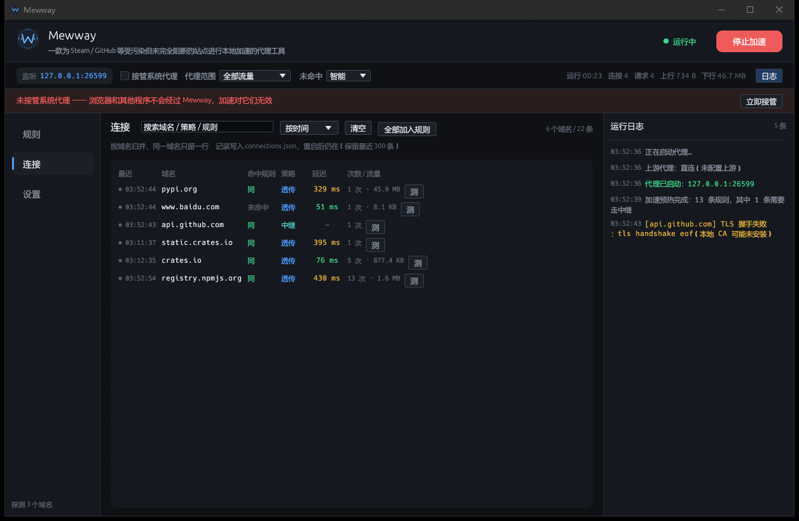
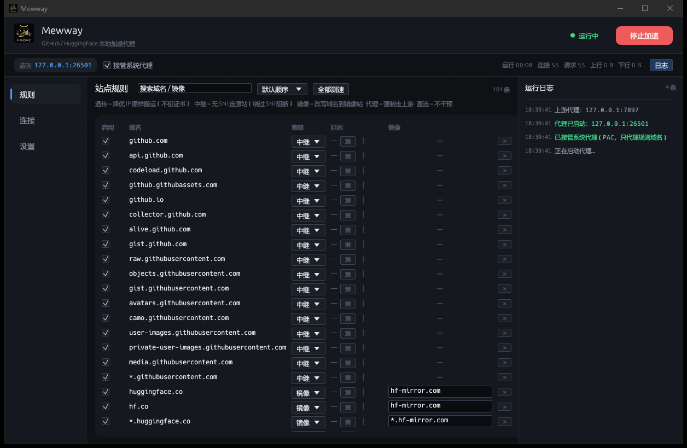
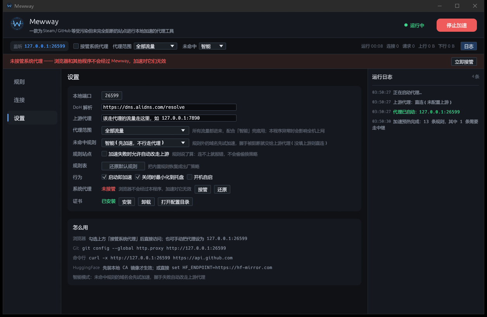

# Mewway


Rust 写的本地加速代理，界面用 egui，常驻托盘。对标 Steam++ / Steam302 的思路：
**不改 hosts、不劫持 DNS，靠「本地代理 + DoH 选真实 IP + 镜像站改写」把 GitHub、HuggingFace、Steam 这些站点拉回来。**



<sub>连接页：每条连接都记着命中了哪条规则、实际走了什么策略、建连耗时、上下行流量。
域名后面的 `*` 表示这条连接中途改过线路（通常是直连不通 / 握手被阻断后改走上游代理），`!` 表示没建成，悬停能看到具体原因。</sub>

| 规则 | 设置 |
| --- | --- |
|  |  |

## 它能做什么

| 能力 | 说明 |
| --- | --- |
| **透传**（Tunnel） | 用 DoH 拿到未被污染的 IP，多个 IP 并发测速，连最快的那个，TLS 原样搬运。**不碰证书、支持任意协议（HTTP/2、WebSocket、私有协议）、CPU 最低** —— 但绕不开 SNI 阻断 |
| **中继**（Relay） | 本地终结 TLS 后用「不带 SNI」的连接去连源站，绕过 SNI 阻断。需要先装本地 CA，只支持 HTTP/1.1，CPU 更高。GitHub 全家走的就是这个 |
| **镜像**（Mirror） | 本地做 TLS 中间人，把 `huggingface.co` 的请求改写到 `hf-mirror.com` 再取回来，响应里的 302 地址也会改写回原域名，下载链接不会漏出去 |
| **代理**（Proxy） | 直接交给上游代理，一次直连都不试。给 pixiv 这种「IP 通但握手必被掐」的站点用 |
| **直连**（Direct） | 完全放行，不经过任何处理 |
| **IP 池** | DNS 只给一个答案，那个 IP 被黑洞时就换一个。内置 GitHub / Steam 等站点的公开入口 IP，全都不通时自动去池子里捞 —— 直连在这一步已经彻底失败了，而这里还有第二次机会 |
| **借 IP** | 自己的解析被污染、IP 池里也没有时，去问「同一 CDN 属性下别的域名」要 IP（`ipdb::SIBLINGS`）。判据是「无 SNI 握手 + 本域名 Host 能拿到 200」，不是「能连上」——Akamai 上不同属性不共享 hostname，连上了也可能只给 403 |
| **自动升级** | 引擎确认某条「透传」规则对应的域名被 SNI 阻断时，会自动把它改成「中继」并写回配置（`auto_escalate`，设置里可关）。所以你不必自己判断哪些站被墙 —— 先都配成透传，被掐的会让程序自己升级成中继 |
| **智能兜底**（可选） | 默认关闭。开启后没命中规则的域名先乐观透传，握手被阻断就当场改走上游 |
| **规则优先** | 命中规则的域名，策略完全由规则决定。**不会被探测结果或自动兜底改写** —— 你写「透传」就是透传，连不上宁可报错让你看见，也不会自己偷偷换成走代理 |
| **分流** | 命中规则的域名由本程序自己加速，**不走上游**；该走代理的才丢给你原来的代理。所以它和 Clash / v2rayN 这类工具是叠加关系，不是替代 |
| **测速** | 每个站点都显示 TCP 握手延迟；**镜像站点测的是镜像域名的延迟**（真正会连的那个） |
| **系统代理接管** | 默认用 **PAC 精确分流**：只有规则表里的域名指向本程序，其余流量系统直连 —— 本程序出问题也只影响那几个站，不会让整台机器断网。也支持全局接管 |
| **系统代理备份** | 开启前备份你原有的代理配置（含 PAC），关闭/退出时原样还原，硬崩溃下次启动也会自动还原 |
| **常驻托盘** | 点关闭是最小化到托盘，托盘菜单可直接启停、退出；支持开机自启 |
| **无界面模式** | `mewway.exe --headless`，日志直接打到控制台，适合当后台服务 |

## 加速的原理

一句话：**被墙的常见形态是「DNS 被污染」「选到了烂 IP」「SNI 被识别」三种，前两种本地能绕开，第三种必须动 TLS。**

```
域名 ──DoH(HTTPS)──▶ 真实 IP 列表 ──并发 TCP 测速──▶ 最快的那个 IP
                                                        │
                                            原始 TLS 字节原样透传
                                                        ▼
                                              浏览器看到的证书、SNI 都没变
```

- **DoH 为什么有用**：普通 DNS 是明文 UDP，53 端口上的应答可以被伪造，于是 `github.com` 被解析到 0.0.0.0 或者某个黑洞 IP。走 `https://dns.alidns.com/resolve` 拿 JSON 结果，这条路是加密的，伪造不了。
- **为什么系统解析的结果也要一起测**：DoH 抗污染，但国内 CDN 恰恰是运营商给的 IP 最近。两边都放进候选集测速，谁快用谁 —— 这也是「加速不可能比直连慢」的硬保证。
- **为什么要有 IP 池**：`github.com` 在某个时段只解析到 `20.205.243.166`，而那个 IP 被黑洞时，直连就彻底没戏了。实测同一时刻 `20.27.177.113` 只要 41ms。所以 DNS 给的 IP 全都不通时，会去公开入口 IP 池里再捞一轮 —— 这是「加速」唯一能在 TCP 层被墙时赢过直连的地方。
- **为什么要「借 IP」**：`steamcommunity.com` 的系统解析、阿里 DoH、腾讯 DoH 各给一个**不同的假 IP**（`108.160.165.212` / `162.220.12.226` / `75.126.164.178`），池子里也未必有它。但同一 CDN 属性下的 `cdn.akamai.steamstatic.com` 解析是干净的，而且边缘按 Host 头路由、共用同一批 IP —— 拿它的 IP 配 `Host: steamcommunity.com` 能直接 200。硬编码 IP 会过期，借来的 IP 跟着兄弟域名的解析走，不会。
- **为什么要测速**：一个域名往往有十几个 IP，其中一部分是给海外用户优化的、一部分直接不可达。ICMP 常年被墙不能用，只能真去 `connect()` 一次量 TCP 握手耗时，取最快且能连上的。
- **为什么只做透传、不做中间人**：TLS 是端到端的，我们只搬字节，不碰明文。所以证书校验、SNI、ALPN、HTTP/2 全都原样工作，也没有任何内容被解密。中间人只在「必须把域名改写成镜像站」或「必须抹掉 SNI」时才用。
- **一个实测数据，决定了 GitHub 必须走中继**：同一个 IP `140.82.112.3`，带 SNI 握手直接超时，不带 SNI 立刻 `HTTP/1.1 200`（1036ms）；`4.237.22.38` 同理（575ms）。所以对 GitHub 纯透传无效，必须本地终结 TLS 再用无 SNI 连出去。

  > 2026-11-04 复测时 `github.com` 的另一个 IP（`20.205.243.166`）直连是通的（148ms）—— **墙是动态的**，
  > 上面这条只说明「曾经被掐过」，不能当成永久结论。判据和实测方法见 [策略规则.md](策略规则.md)。

### 透传和中继：两条互补的线路

「透传」和「中继」是两个**平级**的策略，不是同一个东西的两种叫法，也不能互相替代：

| | 透传 | 中继 |
|---|---|---|
| 碰不碰证书 | 不碰，端到端 TLS 原样搬运 | 本地 CA 终结，再自己建一条 |
| 要装 CA 吗 | 不要 | 要 |
| 支持的协议 | 任意（HTTP/2、WebSocket、私有协议都行） | 只 HTTP/1.1 |
| CPU / 延迟 | 只搬字节，最低 | 两段 TLS，更高 |
| 被 SNI 阻断的站 | 必失败 | 能过 |

既然两条线各有死穴，最省心的做法是：**能透传的都透传（最省、最通用），被 SNI 掐的才交中继**。
但你不用自己判断 —— 引擎会对每个「透传」域名做一次真实 TLS 握手（`probe.rs`）确认它是否被 SNI 阻断，
确认被阻断的那条规则会被自动改成「中继」并**写回配置**（`auto_escalate`，设置里可关），所以下次启动也是中继。
结论按域名缓存并落盘到 `probes.json`（24 小时），启动时再并发预热一轮，浏览器来的时候已经知道该走哪条。
GitHub 这一族内置了「已知被阻断」的种子，冷启动也不会先失败一次。

### 第三种墙：SNI 阻断，以及为什么需要「中继」

TLS 握手的第一条消息（ClientHello）里，**域名是明文的**（SNI 扩展，用来让服务器挑证书）。所以中间设备不需要解密，只要看到 `raw.githubusercontent.com` 就把这条连接 RST 掉。

这种场景下「透传」是无解的：它只是搬字节，ClientHello 里照样写着那个域名。

中继换个打法：

```
浏览器 ──TLS(SNI=raw.githubusercontent.com)──▶ Mewway 用本地 CA 终结
                                                    │
                                    自己建一条 TLS，server_name 填 IP
                                    （按 RFC 6066，IP 不产生 SNI 扩展）
                                                    ▼
                                              源站看到一条「没有域名」的连接
```

链路上只有一段没有域名的密文，阻断规则匹配不上，于是通了。`raw.githubusercontent.com`、
`gist.github.com`、`avatars.githubusercontent.com` 实测从「连接被重置」变成 0.23 秒返回。

代价：必须装本地 CA；只支持 HTTP/1.1（WebSocket 之类不行）；不校验证书（我们只负责把 HTTP 搬过去）。

### 中继为什么还会失败，以及怎么把它救回来

中继只解决了「握手能不能过」，**建起来之后一样会挂**。实测下来有三种，代码里各有对策：

| 现象 | 真实原因 | 对策 |
| --- | --- | --- |
| `中继请求失败：connection error` | 选中的 IP **握手能过、一发请求就断**（同一族里总有这种半死的节点） | 把这个 IP 拉进「冷藏表」90 秒，**换一个 IP 把请求重发一次**。GET/HEAD 这类没有 body 的请求重发是无损的 |
| `connection closed before message completed` | 响应体传到一半，对端没了 | 同上：丢掉这条连接、冷藏这个 IP，下次重建 |
| `N 个候选 IP 都没能完成握手` | 系统解析给了被污染的地址（实测 `steamcommunity.com` 三个来源分别解析到 `108.160.165.212` / `162.220.12.226` / `75.126.164.178`，全是假的），DoH 给的地址 TCP 又不通 | 候选 = 公开 IP 池 + **兄弟域名借来的 IP** + DoH + 系统解析，**扫两轮**（丢一个 SYN 太常见了，隔 150ms 重试往往就通），全失败再试一轮**带 SNI** 的握手 |
| 页面一直转圈，几十秒才报错 | 首字节到了，但 body 一个字节都不来 / 传一半不动 | 首字节 4 秒、body 首个字节 6 秒、body 静默 20 秒 —— 到点就掐，浏览器立刻可以重试 |
| 页面显示站点自己的「请求太多了」/ 429 | **不是加速失败**。能拿到站点自己排版的页面，说明流量已经到站点了，是它按出口 IP 限流。中继不改出口 IP，Akamai 看到的就是你家的公网 IP | 等 5~15 分钟。连接页会给这条连接挂一个黄色 `*`「服务端限流」。真要换出口 IP 只能把规则改成「代理」走上游，代价是变慢 |

几条设计上的取舍：

- **只掐「静默」，不掐「总时长」。** 大文件下载（几十 G 的模型、游戏）本来就要跑很久，总时长超时会把它误杀。
- **冷藏表不能把候选池抽干。** 抖一阵子之后可能所有 IP 都被冷藏，这时宁可去试一个「可疑」的，也比直接告诉用户连不上强。
- **先扫两轮再上 SNI。** 有些多租户 CDN 根本不接受无 SNI 的握手，而它的 SNI 又没被墙 —— 这种情况带真 SNI 反而通。结论按域名记住，下次直接走对的那条。
- **建连时多等 180ms 挑最快的 IP。** 只取「第一个握手完成的」会经常挑中握手快、服务慢的节点（实测同一个 github 首页，好 IP 首字节 0.14 秒，差 IP 4 秒以上）。

## 那「透传也不行」的时候怎么办

透传有个硬边界：**如果 IP 通、但 TLS 握手被 SNI 阻断**，纯透传是看不见握手失败的（它只看到「客户端发了字节，然后连接断了」）。早期版本因此只能让你手动去配规则。

现在有三条路，按代价从低到高：

1. **等它自己升级**：「透传」规则对应的域名一旦被确认 SNI 阻断，引擎会自动把它改成「中继」并写回配置（见上一节），下次访问就是通的；真的一直不行，再把那条规则改成「代理」（交给 Clash）。
2. **智能兜底**（只对未命中规则的流量）：见下面两层机制。
3. **什么都不做**：规则命中的站点会明确报错并告诉你怎么改，不会静默失败。

**第一层：路由前先问一句。** 后台对这个域名做一次真实 TLS 握手（不校验证书，只关心对方肯不肯回 ServerHello），把「能透传 / 必须换一条线路」记成一张表，缓存 10 分钟。路由时直接查表，判定必须换线路的连试都不试透传。

**第二层：第一次访问也能无损回退。** 没有记录时先乐观透传，但代理会**自己把客户端的第一段 TLS 记录（ClientHello）读下来转发**，然后盯着服务器有没有回话：

- 回了 → 正常，继续双向搬运，延迟几乎没变（本来也要等这个 ServerHello）；
- 被关掉（EOF / RST）→ 明确被掐。此时**我们只发过这一段、一个字节都还没被消费**，于是直接换上游代理重放这段 ClientHello，浏览器完全无感；
- 1.5 秒没动静 → **不下结论**。可能只是这个站慢（TTFB 一两秒的站点很常见），也可能被静默丢弃。这时不换线路、也不改规则，把已经发出去的 ClientHello 留在原地继续等，让服务器自己慢慢吐回来。

最后这一条是踩过坑的：早期版本把「1.5 秒没回」直接当成被墙，结果是 **TTFB 慢的站点被当场掐断**（浏览器一个字节都拿不到），而且那条「透传」规则会被永久改成「中继」。上线一段时间后，规则表里有 18 条被这样误判（`steamcommunity`、`discord` 全家、`spotify`、`docker`、`golang` 都成了中继）—— 而中继只支持 HTTP/1.1，Discord 的 WebSocket 会直接坏掉。

所以现在判断「被 SNI 阻断」必须拿到**明确证据**：握手中被 RST，或者握手成功但应用数据被丢。超时一律只当「这一次线路不好」。

这就是为什么「先透传、不行再走上游」可以做到**不失败、只多花一点延迟**。学到结果之后写进那张表，同一域名后续请求直接走上游。

> 代价：被阻断的域名**第一次**访问会多花 1～6 秒（取决于 TCP 建连能不能通）。之后都是毫秒级直连上游。

## 跑起来

```bash
cargo run --release                    # 带界面
cargo run --release -- --headless      # 无界面常驻
cargo build --release                  # 产物 target/release/mewway.exe
```

首次启动自动生成：

```
%APPDATA%\mewway\config.json     # 站点规则、端口、DoH、上游代理
%APPDATA%\mewway\ca.der / ca.key # 本地根证书（仅镜像模式需要）
```

### 三个开关

1. **开始加速** —— 起本地代理（默认 `127.0.0.1:26501`）。
2. **接管系统代理** —— 默认用 PAC 只把规则表里的域名指过来，其余直连；也可以在「设置 → 代理范围」切成全局接管。
3. **安装证书** —— 只有需要「中继」或「镜像」的站点才需要。没装证书时这两类站点会自动降级成透传隧道，不会让你打不开网页。

> 证书装到的是 **当前用户 → 受信任的根证书颁发机构**，不需要管理员权限。卸载在「设置 → 证书 → 卸载」。

### 只允许开一个

同一份配置目录只允许一个进程。双击 exe 时如果已经在跑，新进程会把已有窗口
**顶到前台**然后自己退出，不会再出现「两个实例抢同一个端口、互相覆盖 PAC」。

锁是按**配置目录**算的（命名互斥体 `Local\Mewway-<目录哈希>`），所以
`MEWWAY_HOME` 指向不同目录时可以并存 —— 隔离测试要用这个。

### 设置都存在哪

所有开关（含「接管系统代理」）都写进 `config.json`，改完立即落盘，退出时再存一次。
如果改注册表失败（比如被安全软件拦），「接管系统代理」会**回滚成实际状态**再保存，
不会出现「配置说接管了、其实没有」这种下次启动继续失败的循环。

「设置 → 代理范围」决定影响面：

| 选项 | 行为 |
| --- | --- |
| **只代理规则域名**（默认） | 生成 PAC 精确分流，规则外的网站**根本不经过本程序**。本程序再怎么出问题，也只会影响规则表里那几个域名 |
| **全部流量** | 所有流量都进来。配合「智能」兜底用，但本程序异常时会影响全机上网 |

「设置 → 未命中规则」只在全局接管时有意义：

| 选项 | 行为 |
| --- | --- |
| **放行（不干预）**（默认） | 没命中规则的域名原样放行：系统解析 + 直连，不 DoH、不测速、不碰上游 |
| **智能（先透传，不行走上游）** | 没命中规则的域名先试透传，握手被阻断自动改走上游。**注意**：国内 CDN 会被 DoH 换成泛播 IP，反而更慢，所以不建议默认开 |

## 和别的代理一起用（重点）

典型场景：平时开着 Clash / v2rayN，某天切到「直连」模式，GitHub、Steam、pixiv 就上不去了。

Mewway 的分流规则就是为这个场景设计的：

```
浏览器/游戏客户端
      │  系统代理 = 127.0.0.1:26501
      ▼
   Mewway ──规则=透传/中继/镜像──▶ 自己 DoH 选 IP / 无 SNI 连源站 / 走镜像（绕开你的代理）
      │
      ├──规则=代理──────────▶ 上游代理
      │
      └──未命中（智能）─────▶ 先试透传 ──握手通──▶ 就这么用
                                   └──握手被掐──▶ 换上游代理重放（无感）
```

在「设置 → 上游代理」填你原来代理的地址即可。这样：

- 你的代理继续负责它该负责的流量，切到直连也不影响它自己的规则；
- 规则表里的站点由 Mewway 直接加速，不受你代理模式的影响；
- 连规则表都没覆盖的站点（比如你随手点开的一个外链），也会自动判断该透传还是该走上游；
- 想完全独立使用，把上游留空就行 —— 此时智能模式退化成「全部透传」。

> 注意：同一时刻只能有一个「系统代理」。如果你希望 Clash 继续当系统代理，那就不要开 Mewway 的「接管系统代理」，而是把 Clash 的规则指向 `127.0.0.1:26501`（或直接只用 Mewway 接管 + 上游填 Clash）。

## 默认规则覆盖

| 分组 | 内容 |
| --- | --- |
| GitHub（中继） | `github.com` `api.github.com` `codeload` `githubassets` `github.io` `collector/alive`，以及 `*.githubusercontent.com` 一族：`raw` `objects` `gist` `avatars` `camo` `user-images` `private-user-images` `media` |
| Microsoft（直连） | `*.microsoft.com` `*.microsoftonline.com` `*.live.com` `*.office.com` `*.office365.com` `*.sharepoint.com` `*.onedrive.com` `*.visualstudio.com` `*.vscode.dev` `*.xboxlive.com` `*.xbox.com` `*.msn.com` `*.bing.com` `*.aka.ms` `*.windowsupdate.com` |
| HuggingFace | `huggingface.co` `hf.co` → 镜像 `hf-mirror.com`；`*.huggingface.co` → `*.hf-mirror.com`（`cdn-lfs.*` 自动跟着换） |
| Steam | `store.steampowered.com` `steamcommunity.com` `api.steampowered.com` `login/checkout/help`、`*steamstatic.com` 各 CDN、`steamcdn-a/steamcommunity-a/steamstore-a.akamaihd.net` |
| Spotify | `open/api/accounts.spotify.com` `spclient.wg.spotify.com` `apresolve` `*.scdn.co` `*.spotifycdn.com` |
| EA / Origin | `*.ea.com` `*.origin.com` `accounts.ea.com` `origin-a.akamaihd.net` `eaassets-a.akamaihd.net` |
| Ubisoft / Uplay | `*.ubisoft.com` `*.ubi.com` `ubisoftconnect.com` `public-ubiservices.ubi.com` `cdn.ubi.com` |
| Nexus / mod.io | `*.nexusmods.com` `staticdelivery.nexusmods.com` `files.nexus-cdn.com`、`mod.io` `api/cdn.mod.io` `*.mod.io` |
| 包仓库（直连） | `crates.io` `static.crates.io` `index.crates.io` `pypi.org` `files.pythonhosted.org`（实测带 SNI 3/3 全通、150ms 左右，透传只是白跑一次 DoH） |
| 其他 | Discord、npm、Docker Registry、PyTorch、Node、Go |
| 只能走代理 | `pixiv.net` `*.pixiv.net` `*.pximg.net`（IP 通但握手必被掐，加速无意义） |

共 116 条，全部可在界面里勾选、改策略、增删。没被这 116 条覆盖的域名交给「智能兜底」处理，不用手动加。

> Microsoft 那一族配的是**直连**，看着像「没加速」，其实是把它从兜底流程里摘出来。
> 没命中规则的域名按 `fallback` 走，而 `Auto` 会先 DoH 换 IP、再试透传、握手不成就丢给上游代理 ——
> 对本来就有国内 CDN 的站点是纯负优化。`edge.microsoft.com` 之前就是因为没有规则、
> 落进兜底而走了上游代理，加一条直连才回到系统解析直连。

> **想给一个域名加规则，先看 [策略规则.md](策略规则.md)。** 它按「这个站属于哪一类墙」给判据和
> 实测对比（DNS 污染 / 烂 IP / SNI 阻断 / TCP 黑洞 / 按 IP 掐），并说明了为什么
> `registry.npmjs.org` 这类「一半 IP 被掐」的站点不能配中继。

### 规则页的「节点组」

116 条规则在界面上按站点族归成 14 个组（GitHub / Microsoft / HuggingFace / Steam / Spotify /
Discord / EA-Origin / Ubisoft / Nexus-mod.io / Docker / 包仓库 / 代码托管 / PyTorch / Pixiv），
**默认全部收起** —— 一进来先看到十几个组和它们各自的策略，而不是一百多行域名。

组头那行就是整组的开关：

- 点组名、或者点右侧的「展开 / 收起」，都能折叠；
- 组头的策略下拉和组内每一行的策略**在同一列**，改它就是**批量改这一组**；
- 组头的「测速」按钮只测这一组（和「全部测速」的区别只有范围，**不会**清掉别的组已测出的延迟）；
- 组内策略不一致时显示「混合」，改一次就统一了；
- 展开后每条仍然可以单独改 —— 组策略只是一次性写一批，不会锁住子节点。

组头和组内域名靠三层区分，不靠符号：整行一条底色带 + 左侧一道竖标记 + 组名用更大的字号和更亮的颜色，
组内域名则缩进 30px、压暗一档、用等宽字体。**不用 `▶` `✓` 这类符号** —— egui 自带字体没有字形，会变成豆腐块。

加大缩进不会把策略列推歪：域名列宽度是「剩余宽度 − 430」，缩进吃掉多少，域名列就自动少多少，
组头和子行的策略下拉始终落在同一个 x 上。

分组只是**展示上的归类**（`config::GROUPS`），路由永远按每条规则自己的 `mode` 走，
不存在「组策略」这第二套规则来源。镜像被排除在整组修改之外：它要求逐条填镜像域名，
整组改只会得到一堆空镜像。

自己加的域名如果不在任何组里，会单独列在组下方，不参与折叠。展开状态记在
`config.json` 的 `open_groups` 里，重启后保持。

「测速」按**这条规则实际怎么连**去量，三种规则三种判据 —— 用错判据量出来的数字没有意义：

| 规则 | 量的是什么 | 为什么 |
| --- | --- | --- |
| 直连 | 系统解析 + TCP 握手（`best_system`） | 它实际就是这么连的。掺 DoH 和 IP 池会挑出一个比真实路径更快的 IP，显示出来等于骗自己 |
| 中继 | TCP + **无 SNI 的 TLS 握手**（`best_relay`） | 中继建连就是这么干的（server_name 填 IP）。有些 IP 的 TCP 通、TLS 却被掐，用 TCP 数字显示中继延迟等于骗自己 |
| 其余（透传 / 镜像 / 代理） | 三源合并挑 IP + TCP 握手（`best_fresh`） | 和透传路径一致 |

- **测速不认缓存。** 点第二次一定重新测，不会把三分钟前的结论再显示一遍（`best_fresh` 跳过 `BEST_TTL` 缓存）。
- **测速失败会清掉旧值。** 组测速 / 单条测速只清自己这几条，否则失败的那几条会继续显示上一次的数字，看起来像「点了没反应」。
- 「通不通」看「被阻断」那一列 —— 延迟只回答「连得上、多快」。

规则支持通配，匹配顺序是「精确优先，其次最长的通配后缀」：

```json
{ "host": "*.huggingface.co", "mode": "mirror", "mirror": "*.hf-mirror.com", "enabled": true }
```

`*.huggingface.co` 匹配到 `cdn-lfs.huggingface.co` 时，会按通配位替换成 `cdn-lfs.hf-mirror.com`。

### 规则配置（多套规则集）

规则页左上角的下拉可以存多套规则：「默认」「工作」「游戏」……

- **当前生效的那套就是规则表本身**，切走的其它套存在 `config.json` 的 `profiles` 里 ——
  只维护一份真相，不会出现「改了规则忘了同步」的错位；
- 「+ 新建配置…」会**复制当前这一整套规则**再切过去。内置规则有 116 条，从零建一套不现实；
- 只能删非当前的那套，当前这套要删得先切走；
- 切换只换规则集，端口、上游、系统代理这些设置是共用的。

### 还原默认规则

设置页「规则表 → 还原默认规则」，两段式确认（先点一下变红，4 秒内再点才执行）。

还原会把内置规则恢复成出厂策略，**你自己加的域名会保留**（追加在末尾）——
「还原」不该变成「删数据」，何况那些域名往往是排查了半天才加进去的。

### 添加规则

规则页工具条下面就是输入框：域名 + 策略（选「镜像」还要填镜像域名），支持 `*.example.com` 通配。

连接页里更方便：

- **右键任意一条连接的域名**，菜单里直接选「透传 / 中继 / 直连 / 代理」。
  已经存在的规则会**改策略**，不会插一条重复的。
- 工具条的「**全部加入规则**」把这一页里还没被任何规则覆盖的域名一次加进来
  （默认透传，两段式确认）。按钮上的数字是真正会新增几条 ——
  连接里通常混着一堆 CDN 和统计域名，全灌进规则表只会让它更难维护。

### 给命令行工具用

```bash
git config --global http.proxy http://127.0.0.1:26501
curl -x http://127.0.0.1:26501 https://api.github.com
set HF_ENDPOINT=https://hf-mirror.com     # 不装证书也能用官方镜像
```

## 实现要点

```
src/
├── main.rs              入口：解析参数、起内核线程、开窗口
├── app.rs               egui 界面 + 托盘
├── icon.rs              读 logo.ico（PNG / DIB 两种都认），窗口、托盘、界面共用一份
├── config.rs            配置、站点规则、默认规则表
├── shared.rs            GUI ↔ 内核的唯一通信面（原子计数 + 日志环 + 命令 channel）
├── proxy/
│   ├── engine.rs        独立线程跑 tokio（2 线程），接收 启停/重载/测速
│   ├── server.rs        hyper 监听，CONNECT 分流：隧道 / 中继 / 中间人 / 上游；含握手观察与在线回退
│   ├── relay.rs         无 SNI 中继：终结本地 TLS 后用 IP 当 server_name 连源站（绕过 SNI 阻断）
│   ├── probe.rs         「这个域名能不能透传」的探测表（真实 TLS 握手 + 落盘缓存 + 启动预热）
│   ├── tunnel.rs        TCP 建连：择优 IP / 上游代理 / 系统解析兜底（全部带超时）
│   ├── resolver.rs      DoH(JSON) 解析 + 多 IP 并发测速 + TTL 缓存
│   ├── ipdb.rs          公开入口 IP 池：DNS 给的 IP 全被黑洞时的第二手牌
│   ├── forward.rs       请求转发，流式回传，Location 反向改写
│   ├── mitm.rs          rustls 终结 TLS，按 SNI 即时签发证书
│   ├── ca.rs            本地 CA 生成/持久化/签叶子证书（rcgen）
│   └── rules.rs         域名 → 策略匹配（透传 / 中继 / 镜像 / 代理 / 直连 五选一）
└── sys/
    ├── sysproxy.rs      WinINet 注册表 + 备份还原 + 启动自愈
    ├── pac.rs           生成 PAC：只把规则域名指向本程序，其余 DIRECT
    ├── cert.rs          certutil 安装/卸载/检测根证书
    └── autostart.rs     HKCU\...\Run 开机自启
```

几个设计取舍：

- **默认用 PAC 而不是全局系统代理。** 全局接管意味着本程序任何 bug 都变成「整台机器没网」；PAC 把影响面收窄到规则表，规则外的网站连本程序的代码都不会碰到。这是 FastGithub / dev-sidecar 都不会「把能开的站弄坏」的根本原因。
- **没命中规则就真的不碰。** 曾经默认「所有流量先加速，不行再走代理」，听起来很美，实际把国内 CDN 全拖进来了：系统 DNS 本来给的是就近节点，DoH 换成泛播 IP 后更慢，4 秒预算一到就降级。加速器把能用的东西搞坏，那就不是加速器了。
- **加速必须是直连的超集。** 系统解析的 IP 和 DoH 的 IP 一起测速，DNS 全灭时再翻 IP 池 —— 所以不存在「直连能开、开了加速反而打不开」。
- **隧道优先，中间人只用于必须改写的域名。** 中间人要签发证书，成本和风险都更高；能透传就不 MITM。
- **证书没装就不做中间人。** 否则浏览器直接报 `ERR_CERT_AUTHORITY_INVALID`，用户以为工具坏了。降级成隧道反而无感。
  但「没装」和「还没检测完」必须分开：`certutil` 要起进程、几百毫秒才回来，这段时间里如果按「没装」处理，
  刚启动那一下中继规则会被塞给用户的上游代理（用户代理正好是直连模式就是打不开）。所以是「检测完 + 确实没装」才降级。
- **回退点选在「只发过 ClientHello」那一刻。** 这是唯一能无损换线路的时刻：再往后就有应用层字节了，重放会导致重复请求。
- **响应体流式转发。** 模型权重动辄几十 G，不能整块读进内存；`content-length` 去掉改成 chunked，避免帧长对不上。
- **择优 IP 用的是 TCP 握手耗时，不是 ping。** ICMP 常年被墙，TCP 时延才反映真实可用性。
- **所有建连都自带超时。** Windows 的 SYN 重试能拖到 20 秒以上，不掐断的话「先试透传」会让人以为程序卡死。
- **找到可用 IP 后只再等 250ms。** 否则一个死 IP 的 1.2 秒超时会把整轮拖慢，用户感知就是「卡一下」。
- **自己的出站请求必须 `.no_proxy()`。** 接管系统代理之后，系统代理就是自己；reqwest 默认会读系统代理，
  于是 DoH 请求绕回自己 → 自己等自己解析 → 卡到超时。这个自噬死循环是开「接管系统代理」后必然踩的坑。
- **连接页按域名归并，不是按连接列。** 浏览器一条页面能开出几十条连接（静态资源、preconnect、重试），
  逐条列出来的结果是「github.com 出现 27 次」，等于没有信息。压成一行之后是「最近时间 / 策略 / 延迟 + 次数 / 累计流量」。
- **连接页的延迟要能量到「中继」和「镜像」上。** 中继记的是「从零建一条无 SNI 的 TLS 要多久」（这个数最能说明当前 IP 好不好），
  镜像是「第一条请求发出到拿到响应头」。只量隧道的话，最该看的两种策略全是 `-`，按延迟排序就失去意义了。
- **表格列宽跟着可用宽度变，不是固定截断。** 日志栏一开右边就少 300 多像素，固定截断会把最后一列的「测」
  挤成几像素的缝、点都点不到。现在按可用宽度分三档，窄的时候先砍域名长度、再砍字节数，按钮始终完整。

### 资源占用

- 代理内核 2 个 tokio 工作线程，空闲时纯 epoll 等待，几乎不占 CPU；
- 数据面是 `copy_bidirectional` 零拷贝搬运，不解析、不缓存内容；缓冲区从 tokio 默认的 8KB 调到 32KB（`tunnel::pump`），拖大文件时系统调用数砍到四分之一；
- 握手观察只是把客户端本来就发出来的第一个 TLS 记录多读一次，不额外产生流量；
- DoH 结果缓存 5 分钟、择优 IP 缓存 3 分钟、加速可用性缓存 30 分钟并落盘，不会每条连接都重新探测；
- 中继记住「上次握手成功的地址 + 要不要带 SNI」，后续建连直接单点复用（实测建连耗时中位数 80~90ms），不再每次扫一遍候选；
- 界面运行中 2 fps（500ms）、停止时 0.7 fps；**收进托盘后整帧跳过绘制**，只留 1 秒一次的托盘事件轮询；
- 连接 / 日志 / 测速表按版本号懒拷贝，没变化就不重新克隆；日志面板关掉后连日志都不碰；
- 列表类快照限流到 5Hz（`SNAP_MIN_GAP`）：一个页面几十条连接，每建一条都会 bump 版本号，不限流的话界面每帧都要全量克隆 300 条带 String 的记录；
- 右上角「日志」按钮可随时收起右侧运行日志栏：收起后连接表拿到全部宽度，并且不再从日志环里拷贝；
- 连接记录 30 秒才落一次盘（每次都是全量重写 JSON）；
- 实测空载（15 秒采样，`tools/cpu.py`）：窗口可见 + 日志开 **0.52% 单核**，日志关 **0.42%**，收进托盘 **0.00%**；
  浏览/下载时与直连相当（瓶颈在带宽）。

## 浏览器还是打不开？按这个顺序查

「开了加速但网页还是打不开」几乎都出在下面三条，按顺序排一遍就好：

**1. 系统代理没接管（最常见）**

界面顶部会有一条红条：`未接管系统代理 —— 浏览器和其他程序不会经过 Mewway`。点「立即接管」即可。
没接管的时候 Mewway 只是在后台跑着，浏览器走的是直连，加速对它一点作用都没有。
「设置 → 系统代理」里也能看到当前真实状态（这里读的是注册表，不是配置文件的意向值）。

**2. 上游代理自己挂了**

命中规则之外的站点要靠上游代理兜底。如果你的 Clash/v2rayN 节点挂了，这些站点照样打不开 —— 而且**和 Mewway 无关**。
自查方法：

```bash
curl -x http://127.0.0.1:7897 -m 10 -o /dev/null -w "%{http_code} %{time_total}s\n" https://www.google.com/
```

`000` + 正好 5 秒（Clash 自己的拨号超时）就说明节点是死的，去换个节点。

**3. 连接页里的 `↷` 和 `!`**

- `↷`：这条连接中途改走了上游代理（直连握手被掐断），点域名后面的标记能看到原因；
- `!`：这条连接彻底没建成，悬停看具体是哪一段失败（直连 / 上游分别报什么）。

顺带一个容易踩的坑：Windows 自带的 `curl` 走 schannel，会强制检查吊销状态，而本地 CA 没有 CRL/OCSP，于是报
`CRYPT_E_NO_REVOCATION_CHECK`。这是 curl 的毛病，不是证书没装好 —— 加 `--ssl-no-revoke` 或 `-k` 就行。浏览器（Chrome/Edge）对本地根证书不做强制吊销检查，不受影响。

## 和 FastGithub / dev-sidecar / Watt Toolkit 的差别

这几个工具能长期稳定用，靠的不是算法多聪明，而是**「绝不去碰不该碰的流量」**：

| | FastGithub | dev-sidecar | Watt Toolkit | Mewway |
| --- | --- | --- | --- | --- |
| 流量入口 | 改本机 DNS 指向 127.0.0.1 | 系统代理 + 中国域名白名单 | 改 hosts | **PAC 只代理规则域名**（可切全局） |
| 规则外的流量 | 「其余网页、软件网络访问完全不受影响」 | 「没有配置域名的不会拦截」 | 不碰 | 不碰，连本程序的代码都不到 |
| 绕过 SNI 阻断 | 与源站建**无 SNI** 的 TLS | 中间人改写 | 中间人 | 中继：本地终结 TLS，出站用 IP 当 server_name |
| IP 从哪来 | 内置 GitHub 网段扫描 | DoH 优选 | hosts 里写死 | DoH + 系统解析 + 公开 IP 池 |

Mewway 早期两版都栽在最后一行之外的地方：先是**全局接管系统代理**（本程序任何 bug 都变成整台机器断网），
再是**未命中规则也乐观加速**（把国内 CDN 拖进 DoH，反而更慢）。现在的做法对齐上面三家：
入口用 PAC 收窄、规则外一律不碰、加速本身保证不比直连差。

## 已知边界

- 「透传」能解决 **DNS 污染 / 选到差 IP / 单个 IP 被黑洞**（靠 IP 池换一个）；握手被 SNI 阻断的站点，引擎会自动把那条规则升级成「中继」并保存 —— 但**只有拿到明确证据才升级**（握手中被 RST，或握手成功而数据被丢），超时只算「这一次线路不好」，不改配置。
- 中继能绕过 SNI 阻断，但**绕不过整段网络被封**：如果所有已知 IP 的 `SYN` 都回不来，任何本地手段都无能为力，只能走上游。实测 `store.steampowered.com` / `steamcommunity.com` 在某些时段就是这种状态（直连同样 15 秒超时），这时要么开「规则站点失败兜底」，要么把规则改成「代理」。
- 系统解析被污染时（例如 `steamcommunity.com` 解析到 Facebook 的 `157.240.1.9`），候选 IP 里会有几个必然失败的地址。多扫一轮能救回来一部分，救不回来的只能靠 IP 池或上游。
- **GitHub 的静态资源子域实测是 SNI 阻断型**（`raw.githubusercontent.com` 同一批 IP：带 SNI 握手全被掐，不带 SNI 89~149ms 就能成），所以引擎会给它们选中继。`github.com` 本身是普通 HTML 站，部分时段直连就能成（实测 148ms），整族配中继只是多付一次 MITM，不会打不开 —— 墙会变，宁可稳一点。这一点和 FastGithub 的结论一致。
- 走中继需要本地 CA，并且只走 HTTP/1.1：WebSocket、HTTP/2 独有特性、非 443 端口都不走这条路。这也是为什么不能「全都用中继」—— Steam 客户端、Discord 这类长连接会坏，而且白付两段 TLS 的开销。
- 非 443 端口永远只透传（不做中间人）。
- 智能兜底和在线回退**只作用于未命中规则的域名**。规则命中的站点策略由规则决定，不会被自动改写。
- 智能兜底只覆盖 **CONNECT + 443 端口**的 TLS 流量（也就是 HTTPS）。明文 HTTP 和非标准端口的 TLS 走的是规则表。
- 握手观察依赖「客户端先说话、服务器后说话」，TLS 满足这个前提；其它协议（首字节不是 `0x16`）会跳过观察直接搬运。
- HuggingFace 新版 Xet 存储（`cas-bridge.xethub.hf.co`）不在镜像覆盖范围内，走普通隧道。
- 中间人只谈 HTTP/1.1，WebSocket 之类依赖 Upgrade 的流量在镜像模式下不可用。
- 只处理 HTTP/HTTPS；SOCKS、QUIC/HTTP3 不在范围内（浏览器走系统代理时会自动回落到 TCP）。
- Steam 的「下载加速」本身靠 CDN 就近，规则里加了 CDN 域名只是为了解决解析被污染的情况；游戏内 P2P 流量不经过这里。

## 调试开关

```bash
MEWWAY_FORCE_MITM=1 mewway.exe --headless     # 忽略「证书已安装」检查，强制中间人（配合 curl --cacert 调试）
MEWWAY_HOME=/tmp/mewway-test mewway.exe -H    # 换一个数据目录（便携 / 多开 / 隔离测试，不碰现有配置和系统代理）
cargo test -- --ignored --nocapture           # 跑网络相关的冒烟测试（测速、配置往返）
python tools/fake_upstream.py 18080           # 假上游代理，只记录收到的 CONNECT 和 ClientHello，用来验证在线回退
python tools/diag_relay.py github.com steamcommunity.com   # 对同一 IP 做「带 SNI / 不带 SNI」对比，判断该用透传还是中继
python tools/classify.py registry.npmjs.org   # 快速归类：DNS 污染 / 黑洞 / SNI 阻断 / 按 IP 掐 / 正常（不带参数测一批样本）
python tools/classify.py --dns discord.com    # 只比系统解析和 DoH，看有没有被污染
```

## 安全说明

本地 CA 私钥保存在 `%APPDATA%\mewway\ca.key`，能签发**任何域名**的证书 —— 装进根证书区之后，拿到这把私钥的人可以对你做中间人。
不用的时候在「设置 → 证书 → 卸载」移除，或直接删掉整个 `%APPDATA%\mewway` 目录。
